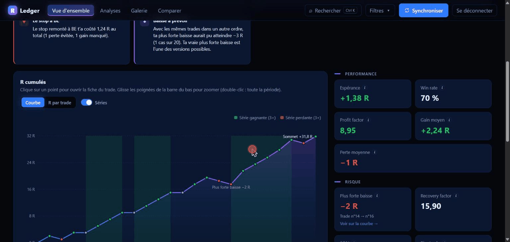
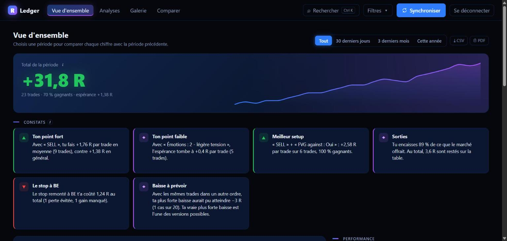
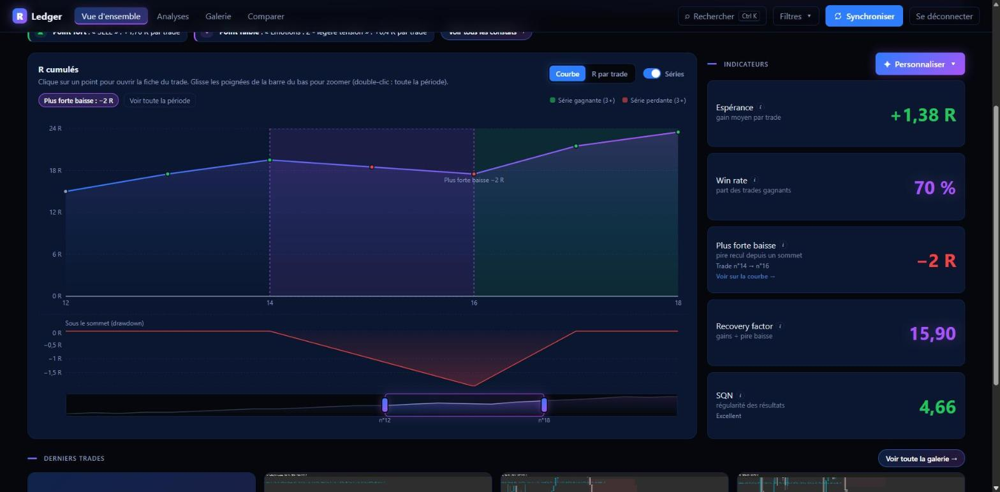
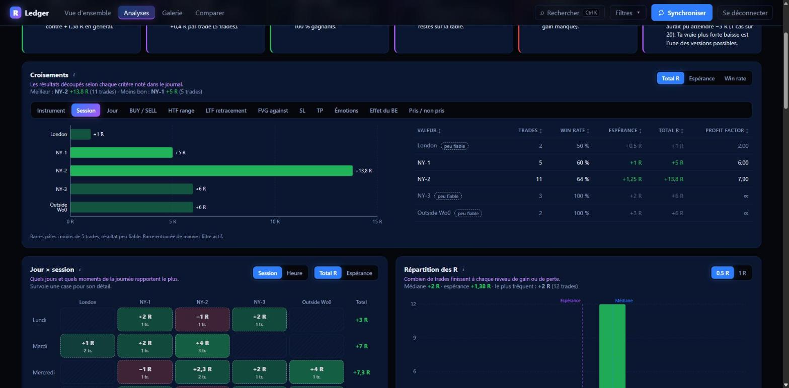
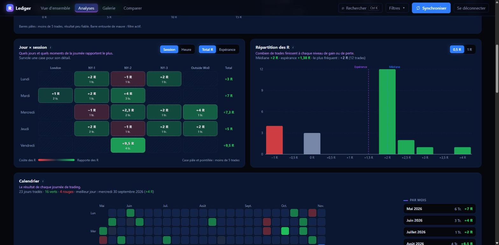
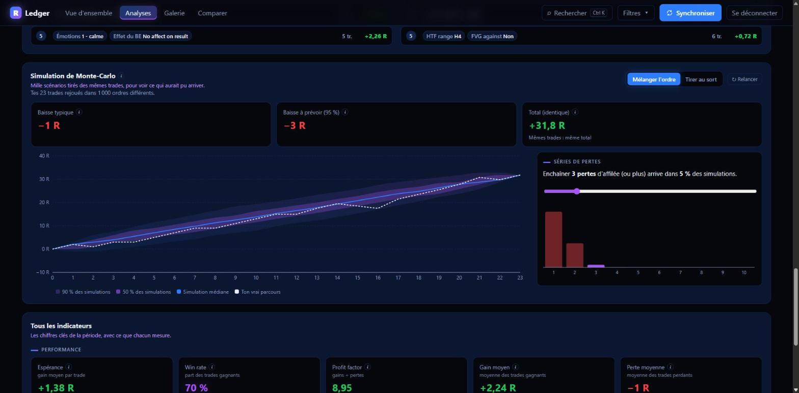
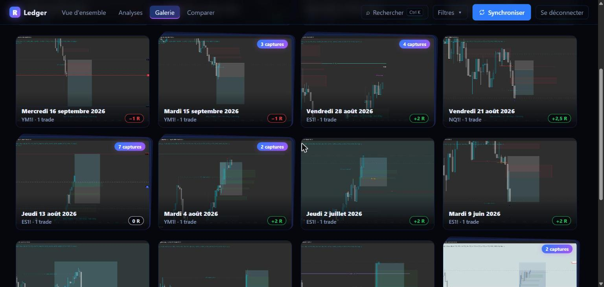
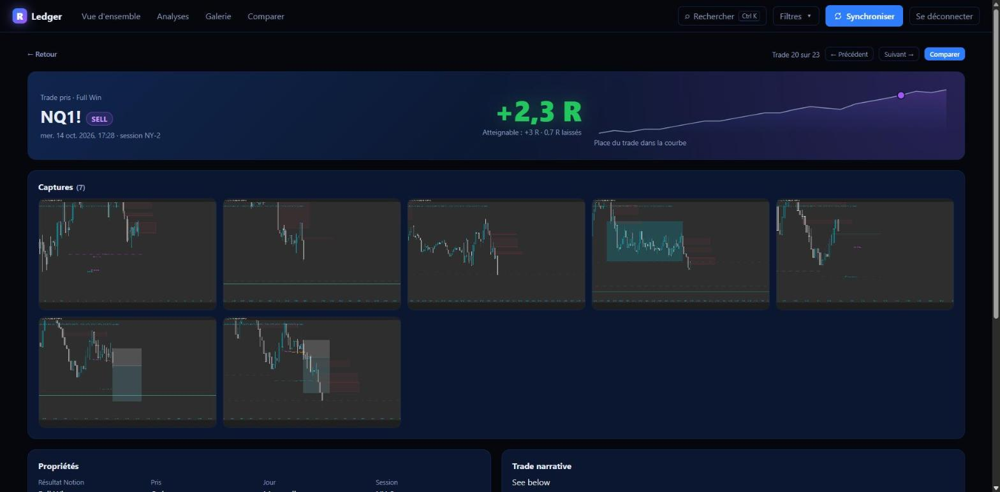
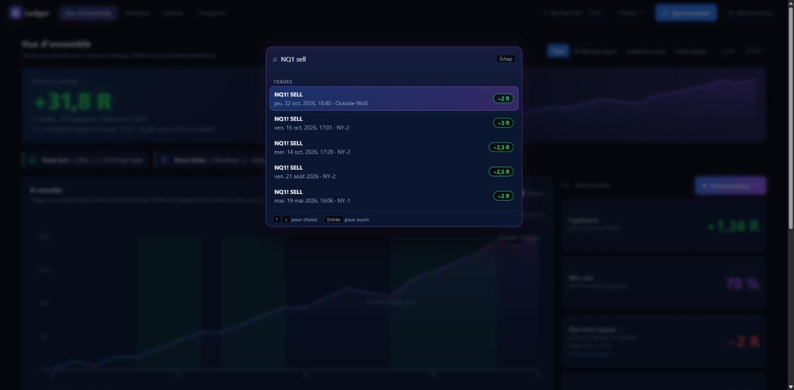
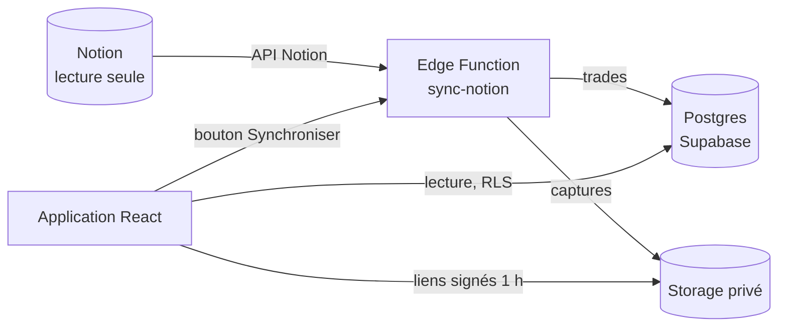

# R Ledger

**Journal de trading qui transforme une base Notion en tableau de bord d'analyse, exprimé uniquement en R** (multiples du risque initial, jamais en devise).

**▶ [Voir la démo en ligne](https://r-ledger-seven.vercel.app)** : bouton « Voir la démo » sur l'écran de connexion (lecture seule, sans inscription).

Les trades sont saisis dans Notion. R Ledger les importe dans Supabase avec leurs captures TradingView, puis montre ce que Notion ne sait pas faire : courbe des R interactive, croisements sur chaque critère, chercheur de setups, simulation de Monte-Carlo, galerie de captures…



---

## Fonctionnalités

### Vue d'ensemble
Total de la période, 14 indicateurs (espérance, profit factor, SQN, recovery factor…) comparés à la période précédente, et **constats rédigés automatiquement** (« ton point fort », « meilleur setup », « baisse à prévoir »), cliquables.



Courbe des R cumulés avec drawdown synchronisé, séries de gains et de pertes surlignées, barre de zoom glissable. Un clic sur une carte (plus forte baisse, plus longue série) zoome la courbe sur le passage concerné ; un clic sur un point ouvre la fiche du trade.



### Analyses
- **Croisements** sur 12 colonnes Notion (session, jour, HTF/LTF, FVG, SL, TP, émotions…) : graphique cliquable qui filtre toute l'application, tableau triable, panneau latéral avec les trades.
- **Carte de chaleur** jour × session (ou heure de Bruxelles), **histogramme** des R, **calendrier** façon GitHub.
- **RR closed contre Achievable RR** : R laissés sur la table et taux de capture (lecture automatique d'un champ texte libre : « RR4 », « Full at 2, Runner at 3 »…).
- **Effet du stop à BE** : R sauvés contre R manqués.
- **Chercheur de setups** : combinaison de critères en direct et classement automatique des combinaisons d'un ou deux critères.
- **Monte-Carlo** : 1 000 parcours (mélange de l'ordre ou tirage au sort), éventail des R cumulés, baisse à prévoir à 95 %, probabilité d'enchaîner N pertes.
- Toute stat calculée sur **moins de 5 trades** est marquée « peu fiable ».





### Galerie, fiches trade, recherche
Galerie des captures regroupées par jour, plein écran au clavier (← →, zoom, miniatures), fiche trade avec navigation précédent / suivant, comparaison de deux trades côte à côte, recherche rapide **Ctrl+K**.





### Et aussi
Filtre global gardé dans l'adresse de la page (une vue filtrée se partage par lien), export **CSV** (prêt pour Excel en français) et **PDF** (mise en page d'impression dédiée), affichage téléphone, navigation au clavier, animations désactivées si le système le demande.

---

## Architecture



- **Synchronisation côté serveur** : le jeton Notion ne quitte jamais le serveur. La fonction (Deno) pagine la base Notion, n'importe que les pages modifiées, télécharge les captures (les liens Notion expirent) et supprime ce qui a disparu de Notion. Elle est relançable sans doublon (clé : l'identifiant de page Notion).
- **Sécurité** : Row Level Security sur toutes les tables, lecture seule pour l'utilisateur connecté, écriture réservée à la fonction ; inscriptions désactivées ; Storage privé servi par liens signés.
- **Données** : colonnes calculées par Postgres (résultat déduit du RR, trade pris ou non) ; dates saisies en heure belge, stockées en UTC, affichées en heure de Bruxelles.

## Stack

| | |
|---|---|
| Interface | React 19, TypeScript, Vite |
| Données | Supabase (Postgres, Auth, Storage, Edge Functions), TanStack Query |
| Navigation | React Router (une adresse par écran, filtres dans l'adresse) |
| Graphiques et animations | Recharts, Motion |
| Qualité | Vitest (63 tests des calculs), Playwright (20 tests de bout en bout), oxlint, types générés depuis la base |

## Choix techniques

- **Tout est en R.** Aucune devise n'est stockée ni affichée ; un test de bout en bout vérifie sur chaque écran qu'aucun montant (« $ », « € ») n'apparaît.
- **Calculs isolés et testés.** Statistiques, croisements, Monte-Carlo (générateur aléatoire à graine, résultats reproductibles), constats et export CSV vivent dans `src/lib/`, sans dépendance à l'interface.
- **Tests de bout en bout sans vraie base.** Playwright lance l'application avec une fausse adresse Supabase et répond à sa place avec des données fictives : aucun mot de passe ni donnée réelle dans les tests, et tout accès à Internet est bloqué pendant les tests.
- **Chargement léger.** Chaque écran et chaque grosse bibliothèque est un fichier séparé (le code propre à l'application pèse 64 ko).

## Lancer le projet

Prérequis : Node.js 22+, un projet Supabase et une intégration Notion (lecture seule).

```bash
npm install
cp .env.example .env        # puis remplir les clés
npm run dev                 # http://localhost:5173
```

Base de données : exécuter `supabase/schema.sql` dans l'éditeur SQL de Supabase, puis déployer la fonction `supabase/functions/sync-notion` avec ses secrets (`NOTION_TOKEN`).

| Commande | Rôle |
|---|---|
| `npm test` | tests des calculs (Vitest) |
| `npm run test:e2e` | tests de bout en bout (Playwright ; `npx playwright install chromium` la première fois) |
| `npm run lint` | vérification du code (oxlint) |
| `npm run build` | version de production |
| `npm run types` | régénère les types TypeScript depuis la base |

## Structure

```
src/
  pages/        un fichier par écran (vue d'ensemble, analyses, galerie, fiche, comparaison)
  components/   panneaux, graphiques, plein écran, recherche Ctrl+K…
  lib/          calculs testés : stats, analyses, Monte-Carlo, setups, constats, filtres, CSV
supabase/
  schema.sql    tables, colonnes calculées, sécurité (RLS), Storage
  functions/    synchronisation Notion → Supabase
e2e/            tests Playwright et données fictives
```
